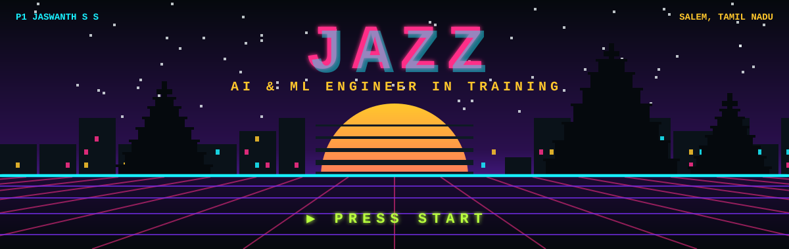

<div align="center">



<a href="https://jazz-portfolio-two.vercel.app">

</a>

[](https://jazz-portfolio-two.vercel.app)
[](https://www.linkedin.com/in/jaswanthss)
[](https://huggingface.co/Jazz716)


</div>

---

## 🕹️ PLAYER SELECT

```text
 NAME      : Jaswanth S S  ("Jazz")
 CLASS     : AI & ML engineer in training
 GUILD     : SRM · CSE (AI & ML) · class of 2029
 HOME      : Salem, Tamil Nadu
 LANGUAGES : Tamil, English (learning Malayalam, Japanese)
 RIG       : RTX 4060 laptop
 STATUS    : OPEN TO AI/ML INTERNSHIPS
```

> **Plan A:** pole vault, cancelled by COVID.
> **Plan B:** *"Tony Stark built his future in a cave."* So I built mine on a laptop. 🦾

```text
 XP  ██████████████░░░░░░  LEVEL: still grinding
 ❤️ SLEEP   ❤️ BUGS   ❤️ DEADLINE        (3 lives, all in use)
```

---

## 🎯 LEVEL 1: QUESTS

### ⭐ Featured boss: [Pakkam](https://github.com/mailtojaswanthss-svg/pakkam) · *"No page, no answer."*

Voice RAG for government schemes in **Tamil, Tanglish, Hindi and English**, and every answer comes with the official page as proof. Built for the **Great Indian AI Internship Challenge 2026** (Gnani.ai), with Mohit K on design and frontend.

| 🎯 Correct citations | 🚫 Out-of-scope refused | 💬 Live questions | ✅ Tests in CI |
|:---:|:---:|:---:|:---:|
| **98%** (133/136) | **98%** (39/40) | **194** | **651** |

Built with **Qdrant** hybrid search (BGE-M3), a reranker, refusal below a confidence threshold, and voice through Gnani.

[](https://pakkam-alpha.vercel.app)
[](https://github.com/mailtojaswanthss-svg/pakkam)

### 🗡️ Side quests

| Quest | Pitch | Loot |
|---|---|---|
| ♟️ [**ChessWise**](https://github.com/mailtojaswanthss-svg/chess-project) | Predicts your blunder *before* you play it | scikit-learn · Stockfish · FastAPI · React/TypeScript · [live](https://chesswise-ai.vercel.app) |
| 🧪 [**OPE Lab**](https://github.com/mailtojaswanthss-svg/ope-lab) | Causal ML: six off-policy estimators side by side, with an honesty rule | Python · 36 tests |
| ⚡ [**Smart Energy Dashboard**](https://github.com/mailtojaswanthss-svg/smart-energy-dashboard) | Energy usage dashboard | React · JavaScript · Python |

---

## 🎒 LEVEL 2: LOADOUT

| 🧠 AI & ML | ⚙️ Backend | 🎨 Frontend | 🧰 Tools |
|---|---|---|---|
| Qdrant · BGE-M3 · reranking · scikit-learn · Stockfish | Python · FastAPI | React · TypeScript · Next.js · JavaScript | Git · Vercel · Hugging Face |


---

## 🏆 LEVEL 3: TROPHY ROOM

- 🥉 **3rd place**, BizzBoss (Datakon)
- 🇮🇳 **Great Indian AI Internship Challenge 2026**: built Pakkam for it
- 🎤 Stage speaker at FIITJEE Global School
- 🎖️ School Pupil Leader · hostel events lead

---

## 👾 FINAL BOSS: LEGACY CODE

```text
 LEGACY CODE  ████████████████████  HP 100%
 ─────────────────────────────────────────
 [1] Write tests   [2] Benchmark   [3] Refactor
 [4] Deploy  (only after tests = CRITICAL HIT)
 [5] Music break  (one-time heal 🎧)
 boss move: "Merge conflict!"
```

*Still undefeated: DSA. We're training.* 🥊

---

## 🎧 PLAYER 1 TRIVIA

- 🕷️ Heroes: Spider-Man · Iron Man · Batman
- 🎮 Plays: Clash of Clans · RDR2 · GTA V
- 🎶 Playlist: Ilaiyaraaja · A. R. Rahman
- 🌱 Always learning: Malayalam, Japanese, and whatever the next project needs

<!-- 🥚 easter egg unlocked: type "vanakkam" on the portfolio and it answers in Tamil. -->

---

## 📊 SCOREBOARD

<div align="center">


</div>

---

<div align="center">

### Player 2, press start? ▶

[](https://jazz-portfolio-two.vercel.app)
[](https://www.linkedin.com/in/jaswanthss)

<sub>© Jazz · made in Salem</sub>

</div>
